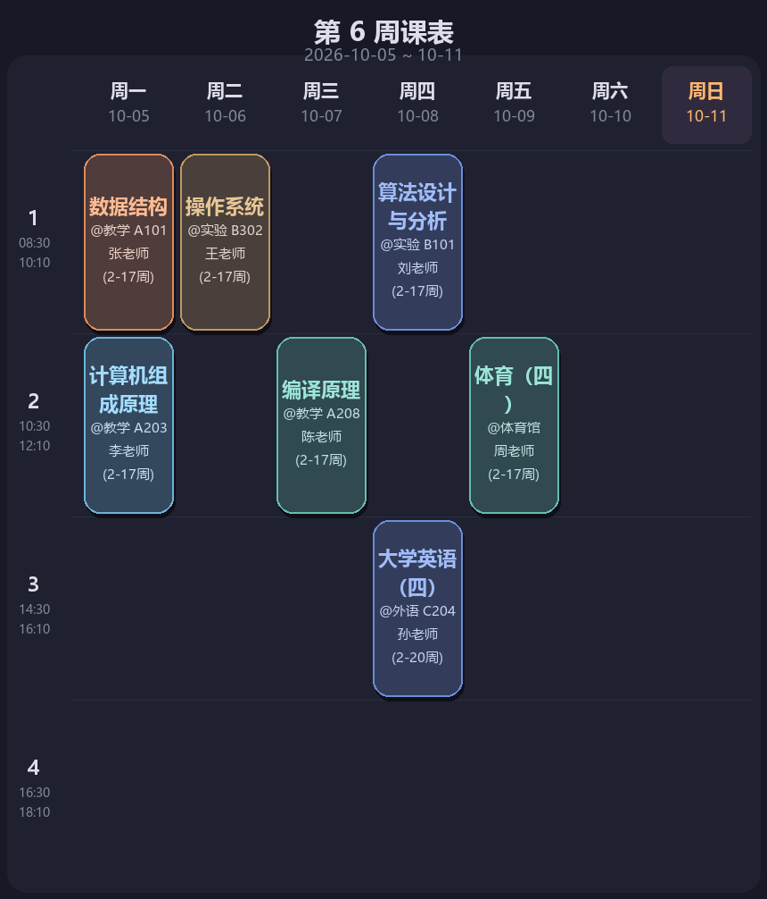

# 校园课表 + 每日新闻 MCP 服务

把「今日课表 / 下一节课 / 本周课表」和「多源热点新闻 / 每日早报」封装成一个
[MCP](https://modelcontextprotocol.io)（stdio）服务，供任何支持 MCP 的客户端调用；
课表还能渲染成深色主题周课表图片，并通过微信通道直接推送。

> 这是一个个人项目：数据源全部是公开接口，微信推送走的是个人通道，**仅供学习与自用**。

## 功能

服务对外暴露 **11 个 MCP 工具**：

| 工具 | 作用 |
|---|---|
| `get_today_schedule` | 指定日期的文字课表（含上课状态、明日预告） |
| `get_next_course` | 下一节课 + 倒计时 |
| `get_week_schedule` | 本周课表总览 |
| `get_schedule_image` | 渲染深色主题周课表 PNG（返回图片内容） |
| `send_schedule_image_to_wechat` | 渲染并直推图片到微信 |
| `get_hot_news` | 今日热点新闻（按板块配额排序，附近期气候趋势） |
| `get_weather_climate` | 未来 7 天温度区间 / 天气概况 / 降水天数 / 升降趋势 |
| `get_morning_report` | 完整早报（课表 + 气候 + 新闻） |
| `handle_command` | 自然语言总入口（"明天课表""下一节""早报""多关注考研""科技少一点"） |
| `get_news_prefs` / `set_news_prefs` | 查看 / 动态调整新闻偏好 |

## 架构

```
        MCP 客户端（Cherry Studio / Claude Desktop / 任意 MCP Host）
                          │  stdio (JSON-RPC)
                          ▼
              src/class_schedule_mcp.py  ← 工具定义与调度
                 │            │              │
   课表引擎 ◄────┘            │              └────► 新闻聚合器
   src/today_schedule.py      │                    · 9 个公开源并发抓取
   config/courses.json        │                    · 去重 + TTL 缓存 + 单源降级
   （周次 / 单双周 / 节假日）   │                    · 板块配额排序（config/news_prefs.json）
                              ▼
                    src/schedule_image.py（Pillow 直绘周课表 PNG）
                              │
                              ▼
                    微信通道直推（可选，见下）
```

## 快速开始

```bash
git clone <this-repo> && cd class-schedule-mcp
python -m pip install -r requirements.txt

# 1) 课表：仓库自带一份虚构样例，可直接跑；换成你自己的：
python tools/convert_xls.py 你的课表.xls          # 教务系统导出 → schedule_data.json
cp schedule_data.json config/courses.json

# 2) 新闻偏好：仓库自带样例（城市默认北京，可改 config/news_prefs.json 的 city/city_code）

# 3) 自测：离线断言 + 协议级握手（真实起进程跑 initialize / tools/list / tools/call）
python tests/verify_news_pipeline.py
python tests/test_mcp_handshake.py

# 4) 接入 MCP 客户端：把 config/cherry-studio-mcp.example.json 的内容填进客户端配置，
#    注意把 <REPO_DIR> 换成本仓库的绝对路径，command 用你的 python
```



## 配置

`config/courses.json`（课表，由 `tools/convert_xls.py` 生成）：

```json
{
  "meta": { "student": "示例大学  学生个人课表", "semesterStart": "2026-09-07" },
  "courses": [
    {
      "name": "数据结构", "teacher": "张老师", "location": "教学楼 A101",
      "day": 1, "startPeriod": 1, "endPeriod": 2,
      "startWeek": 1, "totalWeeks": 20, "weekType": "all",
      "weeks": [2, 3, 4], "note": ""
    }
  ]
}
```

- `day`：1=周一 … 7=周日；`startPeriod`/`endPeriod`：第几大节（1–6）
- `weekType`：`all` / `odd`（单周）/ `even`（双周）；`weeks` 是实际生效周次

`config/news_prefs.json`（新闻偏好，可在对话里用自然语言改）：

| 字段 | 说明 |
|---|---|
| `interest` | 兴趣板块，排在最前 |
| `categories` | 每个板块的图标、条数配额与关键词 |
| `max_tech_items` | 科技类（AI + 科技大厂）合计上限，默认 3 条 |
| `hot_items` | 全网热搜兜底条数 |
| `blocked` | 屏蔽词（默认只挡娱乐八卦绯闻） |
| `sources` | 各新闻源开关 |
| `quiet_sources` | 不参与热搜兜底的来源，避免重复霸屏 |
| `city` / `city_code` | 气候模块城市（[城市编码查询](https://www.weather.com.cn/weather/101010100.shtml)） |
| `show_weather` | 是否在新闻/早报开头附近期气候 |

## 测试

| 脚本 | 作用 |
|---|---|
| `tests/test_mcp_handshake.py` | 真实拉起服务进程，走 `initialize` / `tools/list` / `tools/call`，断言工具数量与名称 |
| `tests/verify_news_pipeline.py` | 离线断言：桩掉 MCP 依赖后直接执行服务源码，用模拟数据校验板块配额与排序 |
| `tests/live_test_news.py` | 联网抽查：只开部分源，看真实返回的分类与来源分布 |
| `tests/test_cn_weather_parse.py` | 正则探针：验证中国天气网 7 天页的解析 |

## 设计要点

详见 [`docs/design-notes.md`](docs/design-notes.md)，几个关键取舍：

1. **课表图片由服务端直推，不经过智能体转发**——转发链路不稳定，图片容易丢。
2. **新闻用"板块配额制"而不是关键词加权**——加权会让科技类内容刷屏（实测占比一度到 77%），
   改成配额后压到约四分之一，且科技类排在最后。
3. **用工具描述约束模型行为**——返回内容即完整回复、新闻只原样转发不评论，避免智能体"加戏"。
4. **多源降级**——9 个源并发抓取，单源失败不影响其他板块，输出末尾标注当天不可用的源。

## 数据来源

新闻：澎湃新闻、百度热搜（realtime/民生/财经/国际）、B 站排行、60s 聚合（IT/微博/知乎/抖音）等公开接口。
天气：中国天气网（主）、wttr.in（兜底）。节假日：timor.tech。
以上均为第三方公开接口，请遵守各自的使用条款；本项目不对其可用性与内容负责。

## 已知限制

- 微信图片直推依赖第三方通道，需要通道侧存在活跃会话，且相关配置在客户端本地；
  不配置时其余工具不受影响（图片会正常返回，只是不推送）。
- `tools/convert_xls.py` 针对特定教务系统导出的表格结构编写，其他学校可能需要改列映射。
- 新闻源可能限流（如 60s 聚合返回 Cloudflare 1027），此时其余源仍然工作。

## English summary

An MCP (stdio) server that exposes **campus timetable queries** and **multi-source trending news**
as 11 tools, renders a dark-theme weekly timetable PNG with Pillow, and can push that image
straight to WeChat. Ships with protocol-level handshake tests, offline assertions and design notes.

```bash
pip install -r requirements.txt
python tests/verify_news_pipeline.py      # offline assertions (stubs the MCP layer)
python tests/test_mcp_handshake.py        # real stdio handshake: initialize / tools/list / tools/call
```

Point your MCP client at `config/cherry-studio-mcp.example.json` (replace `<REPO_DIR>`).
Timetable and news preferences live in `config/courses.json` and `config/news_prefs.json` —
both are fictional samples here. News is aggregated from public APIs; the WeChat push is optional.

## License

MIT，见 [LICENSE](LICENSE)。
