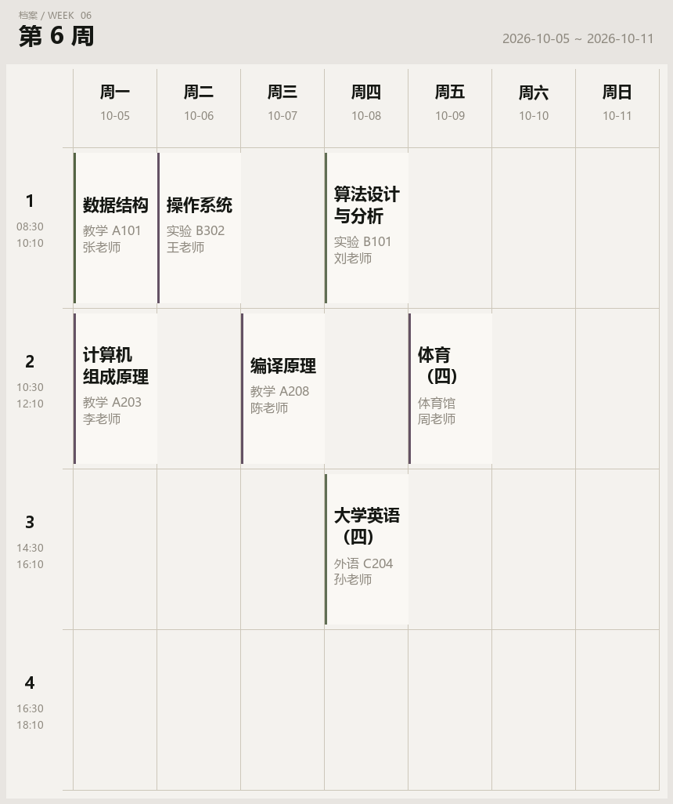

# 校园课表 + 每日新闻 MCP 服务

把「今日课表 / 下一节课 / 本周课表」和「多源热点新闻 / 每日早报」封装成一个
[MCP](https://modelcontextprotocol.io)（stdio）服务，供任何支持 MCP 的客户端调用；
课表还能渲染成深色主题周课表图片，并通过微信通道直接推送。

> 这是一个个人项目：数据源全部是公开接口，微信推送走的是个人通道，**仅供学习与自用**。

**在线演示**：<https://adler862.github.io/class-schedule-mcp/> —— 打开即用的离线课表页面（示例数据），
不联网、不请求任何外部资源。该页面由 `docs/index.html` 提供，用
`python tools/build_single.py --out docs/index.html` 从同一套引擎构建。

## 功能

服务对外暴露 **11 个 MCP 工具**：

| 工具 | 作用 |
|---|---|
| `get_today_schedule` | 指定日期的文字课表（含上课状态、明日预告） |
| `get_next_course` | 下一节课 + 倒计时 |
| `get_week_schedule` | 本周课表总览 |
| `get_schedule_image` | 渲染深色主题周课表 PNG（返回图片内容） |
| `send_schedule_image_to_wechat` | 渲染并直推图片到微信 |
| `get_hot_news` | 今日热点新闻（按板块配额排序，附近期气候趋势） |
| `get_weather_climate` | 未来 7 天温度区间 / 天气概况 / 降水天数 / 升降趋势 |
| `get_morning_report` | 完整早报（课表 + 气候 + 新闻） |
| `handle_command` | 自然语言总入口（"明天课表""下一节""早报""多关注考研""科技少一点"） |
| `get_news_prefs` / `set_news_prefs` | 查看 / 动态调整新闻偏好 |

## Web 版（浏览器直接用，不需要 MCP 客户端）

MCP 服务只能被 AI 客户端调用，普通同学用不上——教务系统导出的那张课表图，
还是得靠截图每周对。本分支给同一套引擎加了一层 Web 入口：

```bash
python src/server.py                    # http://127.0.0.1:8765
python src/server.py --host 0.0.0.0     # 手机连同一局域网访问
```

- **周课表网格**：6 大节 × 7 天，单双周课程自动过滤，今天所在列高亮
- **问一句**：`明天几节课` / `下一节` / `哪天空` / `数据结构什么时候上`
- **导出 `.ics`**：整学期课程一次性导入手机日历。一门课一个 `VEVENT` + `RRULE`，
  而不是逐周展开——前者 8 条，后者上百条，手机日历里会很难看
- **深链**：`?q=明天几节课` 可以把问题带在链接里，方便分享
- **调课**：点课程块把某一次课挪到别的天/别的周，或标记停课（不改课表定义）

零第三方依赖，只用标准库；Pillow 只在要用到图片渲染时才需要。

### 单文件版：双击就开，可以离线

服务版要用户先跑 `python src/server.py`，对不碰命令行的人等于不可用。
所以另外提供一个自包含 HTML：

```bash
python tools/build_single.py                     # → dist/课表助手.html（示例数据）
python tools/build_single.py --courses 我的课表.json --out dist/我的课表.html
python tools/build_single.py --date 2026-11-02   # 把某天当作"今天"，截图/演示用
```

这个文件把课表数据、渲染、问答、日历导出全塞进去了，**双击打开就能用**：
不联网、不用 Python、不用装任何东西，可以直接发微信或拷到手机上。

构建时由 `semester.py` 把所有周的网格**预先算好**内联进去，
所以周次、单双周这些容易算错的规则仍然只有一份实现，前端只做查表。

`--date` 只写进 `DATA.today`，正常构建时该字段是 `null`，页面一律读系统时间——
否则文件放两个月不动，它会"卡"在构建那天，比不用还糟。

窄屏（≤430px）下课程块只有 40 多像素宽，地点全称只能显示成「东校区…」等于没写，
所以构建时另存一个 `room`（`东校区仁智楼A207` → `A207`），窄屏只显示它。

| 接口 | 作用 |
|---|---|
| `GET /api/meta` | 班级、学期起点、当前周次 |
| `GET /api/week?week=N` | 整周课表（省略 `week` 用当前周） |
| `GET /api/today?date=YYYY-MM-DD` | 某日课表 + 下一节课倒计时 |
| `GET /api/ask?q=…` | 自然语言问答，返回 `{intent, text, data}` |
| `GET /api/export.ics` | 日历订阅 |

### 点一下就调课

点任意课程块，选「下周 / 周五 / 第 3 大节」，确认即可。原位置会空出来，课程块出现在
新位置并带一个「调」字标记；再点它就能撤销。周条下方会出现「已记录 N 处调课」，可一键全部撤销。
停课同理，点块选「本次停课」。

**为什么是「例外」而不是改课表**：`编译原理` 的定义是「周二 1-2 节，第 2-17 周」，
直接把它改成周五，前面上过的周次也会跟着变，整学期历史就乱了。所以这里不改定义，
只在上面叠一层「这一次」：某门课某天某节的这一节，挪到别处或取消。定义保持原样。

数据存在哪，两个版本不一样：

| | 单文件版 | `python src/server.py` |
|---|---|---|
| 存在哪 | 浏览器 localStorage | 服务端 `config/overrides.json` |
| 换设备 | 不同步，清缓存会丢 | 跟着文件走 |
| 适合 | 发同学、离线看 | 自己日常用 |

服务端版的接口是 `GET/POST /api/overrides`，`config/overrides.json` 已加进 `.gitignore`
——调课是个人状态，不该提交，也不该被构建进 Pages 演示页（`build_single` 显式传
`overrides=[]` 就是这个原因）。

## 导入你自己的课表

教务系统导出的「学生个人课表」xls 可以直接转成本项目的数据格式：

```bash
# 1. 解析（--start 是学期首周周一，必须自己给，见下）
python tools/convert_xls.py 学生个人课表.xls --start 2026-08-31 --out config/mine.json

# 2. 打包成单文件
python tools/build_single.py --courses config/mine.json --out dist/我的课表.html
```

**`--start` 为什么必须手动给**：导出文件里只有「打印日期」，而打印日期可能是学期中
任意一天（本人这份是 2026-11-01，第 10 周）。拿它当学期起点，整学期的周次会偏移九周。

**`--mask-teacher`**：把教师姓名换成「姓 + 老师」（`张伟` → `张老师`，复姓保留
`欧阳修` → `欧阳老师`），其余字段一律不动。仓库里的 `config/demo-courses.json` 就是
这样生成的 —— 它同时是 GitHub Pages 演示页的数据源，所以不含任何教师全名。

解析器复用自微信小程序项目 `WXClassTable` 的 `tools/convert_xls.py`，这里只加了
`--out` / `--start` / `--mask-teacher` 三个参数，解析逻辑没动。

## 3D 档案版

在线看：<https://adler862.github.io/class-schedule-mcp/3d.html>

**一本脊 = 一周**，17 本横排立在架上；后方两排更矮的装饰脊撑出"档案库"的密度
（参考壁纸里看着几十根，但它的索引写的是 `ARCHIVE INDEX (7)`——真档案只有个位数，
密度来自背景脊）。有课的周是高脊并带一枚低饱和色标，没课的缩到 62% 并淡下去。

选中的那本**原位抬起一截**，从它顶部拉一条细引线到画面空白处，标注周次、日期、
这一周几门课几节，以及一个「打开课表」入口。引线会自动选空白一侧

**左键点任意一根脊**就在当前页底部弹出那一周的课表，不跳转——以前是
`<a href="index.html">`，一点整个 WebGL 场景重新初始化，那一瞬间必然是白的。

面板里是**正经课表网格**（7 列星期 × 6 大节，左列节次带时刻，课程块按课程配色），
不是按天罗列的清单。展开时 HUD 淡出、相机后退到 0.93 让出层次；面板开着时按 `←` `→`
会同步换周；`×` / 点遮罩 / `Esc` / 再点同一根脊都能关。
面板底部另留一个「在表格里看完整学期 →」的次要出口。
（脊在中线右侧就往左拉），不然文字免不了压住几根脊。

```bash
cd web3d
npm install          # three + esbuild，仅构建时需要
npm run build        # → ../docs/3d.html（约 542 KB 单文件）
```

构建时会校验 `config` 里的 `meta.semesterStart` 和课程的 `weeks`：缺了任何一个直接失败。
这不是洁癖——少了 `start` 会让 `new Date("undefinedT00:00:00")` 变成 Invalid Date，
一路算到 `slots[NaN] === undefined`，覆盖层与引线全部静默失效，而模板里的静态默认文案
（第 09 周 / WEEK 09）会假装一切正常。这个坑实实在在踩过一轮。

**为什么要打包**：`three` 从 r160 起不再提供 UMD 构建，只有 ES module；而 `file://` 下
`import` 会被 CORS 拦掉。所以用 esbuild 打成一个 IIFE 内联进 HTML，双击也能用。

课表数据在**构建时**注入（`window.DATA`），运行时零请求。改完 `config/demo-courses.json`
要重新 `npm run build`。

体积代价：主站 93 KB，3D 版 550 KB。所以 3D 是独立页面，主页绝不加载它。

## 架构

```
        MCP 客户端（Cherry Studio / Claude Desktop / 任意 MCP Host）
                          │  stdio (JSON-RPC)
                          ▼
              src/class_schedule_mcp.py  ← 工具定义与调度
                 │            │              │
   课表引擎 ◄────┘            │              └────► 新闻聚合器
   src/today_schedule.py      │                    · 9 个公开源并发抓取
   config/courses.json        │                    · 去重 + TTL 缓存 + 单源降级
   （周次 / 单双周 / 节假日）   │                    · 板块配额排序（config/news_prefs.json）
                              ▼
                    src/schedule_image.py（Pillow 直绘周课表 PNG）
                              │
                              ▼
                    微信通道直推（可选，见下）
```

## 快速开始

```bash
git clone <this-repo> && cd class-schedule-mcp
python -m pip install -r requirements.txt

# 1) 课表：仓库自带一份虚构样例，可直接跑；换成你自己的：
python tools/convert_xls.py 你的课表.xls          # 教务系统导出 → schedule_data.json
cp schedule_data.json config/courses.json

# 2) 新闻偏好：仓库自带样例（城市默认北京，可改 config/news_prefs.json 的 city/city_code）

# 3) 自测：离线断言 + 协议级握手（真实起进程跑 initialize / tools/list / tools/call）
python tests/verify_news_pipeline.py
python tests/test_mcp_handshake.py

# 4) 接入 MCP 客户端：把 config/cherry-studio-mcp.example.json 的内容填进客户端配置，
#    注意把 <REPO_DIR> 换成本仓库的绝对路径，command 用你的 python
```



## 配置

`config/courses.json`（课表，由 `tools/convert_xls.py` 生成）：

```json
{
  "meta": { "student": "示例大学  学生个人课表", "semesterStart": "2026-09-07" },
  "courses": [
    {
      "name": "数据结构", "teacher": "张老师", "location": "教学楼 A101",
      "day": 1, "startPeriod": 1, "endPeriod": 2,
      "startWeek": 1, "totalWeeks": 20, "weekType": "all",
      "weeks": [2, 3, 4], "note": ""
    }
  ]
}
```

- `day`：1=周一 … 7=周日；`startPeriod`/`endPeriod`：第几大节（1–6）
- `weekType`：`all` / `odd`（单周）/ `even`（双周）；`weeks` 是实际生效周次

`config/news_prefs.json`（新闻偏好，可在对话里用自然语言改）：

| 字段 | 说明 |
|---|---|
| `interest` | 兴趣板块，排在最前 |
| `categories` | 每个板块的图标、条数配额与关键词 |
| `max_tech_items` | 科技类（AI + 科技大厂）合计上限，默认 3 条 |
| `hot_items` | 全网热搜兜底条数 |
| `blocked` | 屏蔽词（默认只挡娱乐八卦绯闻） |
| `sources` | 各新闻源开关 |
| `quiet_sources` | 不参与热搜兜底的来源，避免重复霸屏 |
| `city` / `city_code` | 气候模块城市（[城市编码查询](https://www.weather.com.cn/weather/101010100.shtml)） |
| `show_weather` | 是否在新闻/早报开头附近期气候 |

## 测试

| 脚本 | 作用 |
|---|---|
| `python -m unittest discover -s tests/unit -t .` | 单元测试：学期引擎 / Web API / ICS 导出 / 单文件构建 / MCP 输出回归（73 个） |
| `tests/test_mcp_handshake.py` | 真实拉起服务进程，走 `initialize` / `tools/list` / `tools/call`，断言工具数量与名称 |
| `tests/verify_news_pipeline.py` | 离线断言：桩掉 MCP 依赖后直接执行服务源码，用模拟数据校验板块配额与排序 |
| `tests/live_test_news.py` | 联网抽查：只开部分源，看真实返回的分类与来源分布 |
| `tests/test_cn_weather_parse.py` | 正则探针：验证中国天气网 7 天页的解析 |

## 设计要点

详见 [`docs/design-notes.md`](docs/design-notes.md)，几个关键取舍：

1. **课表图片由服务端直推，不经过智能体转发**——转发链路不稳定，图片容易丢。
2. **新闻用"板块配额制"而不是关键词加权**——加权会让科技类内容刷屏（实测占比一度到 77%），
   改成配额后压到约四分之一，且科技类排在最后。
3. **用工具描述约束模型行为**——返回内容即完整回复、新闻只原样转发不评论，避免智能体"加戏"。
4. **多源降级**——9 个源并发抓取，单源失败不影响其他板块，输出末尾标注当天不可用的源。

## 数据来源

新闻：澎湃新闻、百度热搜（realtime/民生/财经/国际）、B 站排行、60s 聚合（IT/微博/知乎/抖音）等公开接口。
天气：中国天气网（主）、wttr.in（兜底）。节假日：timor.tech。
以上均为第三方公开接口，请遵守各自的使用条款；本项目不对其可用性与内容负责。

## 已知限制

- 微信图片直推依赖第三方通道，需要通道侧存在活跃会话，且相关配置在客户端本地；
  不配置时其余工具不受影响（图片会正常返回，只是不推送）。
- `tools/convert_xls.py` 针对特定教务系统导出的表格结构编写，其他学校可能需要改列映射。
- 新闻源可能限流（如 60s 聚合返回 Cloudflare 1027），此时其余源仍然工作。

## English summary

An MCP (stdio) server that exposes **campus timetable queries** and **multi-source trending news**
as 11 tools, renders a dark-theme weekly timetable PNG with Pillow, and can push that image
straight to WeChat. Ships with protocol-level handshake tests, offline assertions and design notes.

```bash
pip install -r requirements.txt
python tests/verify_news_pipeline.py      # offline assertions (stubs the MCP layer)
python tests/test_mcp_handshake.py        # real stdio handshake: initialize / tools/list / tools/call
```

Point your MCP client at `config/cherry-studio-mcp.example.json` (replace `<REPO_DIR>`).
Timetable and news preferences live in `config/courses.json` and `config/news_prefs.json` —
both are fictional samples here. News is aggregated from public APIs; the WeChat push is optional.

## License

MIT，见 [LICENSE](LICENSE)。
